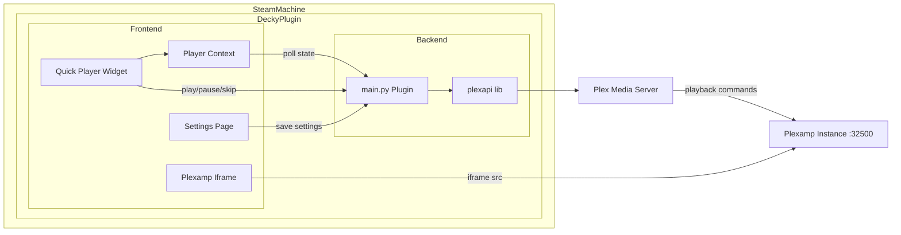

# Requirements

### Overview & Goals

Build a **Decky Loader plugin** for Steam Machine that integrates **Plexamp** music streaming. The plugin provides two experiences:
1. A **full Plexamp web UI embed** for browsing libraries, searching, and full control.
2. A **compact quick-access player widget** in the Decky sidebar for basic playback controls (play/pause/skip/volume) while gaming.

### User Stories

- As a Steam Machine user, I want to open Plexamp from the Decky menu so I can stream music without leaving Big Picture Mode.
- As a gamer, I want quick playback controls (play/pause/skip/volume) in the sidebar so I can manage music while playing.
- As a user with Plexamp running on another device, I want to configure the Plexamp instance URL so the plugin connects to it.

### Scope

**In Scope:**
- Decky plugin scaffold (TypeScript/React frontend + Python backend)
- Plexamp web UI embed via iframe
- Quick-access player controls widget
- Settings page for Plexamp URL, Plex server URL, auth token, and player selection
- Playback state polling and control via `plexapi`

**Out of Scope:**
- Running Plexamp or Plex Media Server (user manages these separately)
- Native controller navigation inside the iframe (relies on Steam's virtual MNK)
- Music library browsing in the custom widget (use the full embed for that)

# Technical Design

### Current Implementation

The project is a **greenfield repository** (empty `.git`, `.venv`, `.idea` only). No existing code to extend.

### Key Decisions

- **Iframe embed for full UI**: Plexamp's web interface (port 32500) is embedded via `<iframe>`. This is the simplest approach and gives users the full Plexamp experience. Steam's virtual MNK handles input.
- **plexapi for playback control**: The Python backend uses `plexapi` to discover Plexamp players on the Plex server and send playback commands (play, pause, skip, volume). This is the same approach used by Home Assistant and other integrations.
- **Settings via Decky's ServerAPI**: Plugin settings (Plexamp URL, Plex server URL, auth token, player selection) are persisted via the Python backend to a JSON config file.
- **Polling for state**: The frontend polls the backend every 2-3 seconds for playback state updates, similar to the YouTube Music Decky plugin pattern.

### Proposed Changes

**Frontend (`src/`):**
- `index.tsx` — Plugin entry point with `definePlugin`, tabs container (Quick Access + Settings), and routing.
- `components/PlexampEmbed.tsx` — Full-screen iframe embed of the Plexamp web UI.
- `components/QuickPlayer.tsx` — Compact player widget: track info, album art, play/pause/skip/volume controls.
- `components/SettingsPage.tsx` — Settings for Plexamp URL, Plex server URL, auth token, and player selection.
- `context/PlayerContext.tsx` — React context for playback state, synced via polling.

**Backend (`main.py`):**
- `Plugin` class with methods: `get_settings()`, `set_settings()`, `get_playback_state()`, `play()`, `pause()`, `skip_next()`, `skip_previous()`, `set_volume()`, `get_current_track()`, `discover_players()`.
- Uses `plexapi.PlexServer` to connect to the user's Plex server and find the Plexamp player by machine identifier.
- Sends playback commands to the Plexamp player via `plexapi.client.PlexClient`.

### File Structure

```
DeckyPlex/
├── assets/                  # Plugin icon, etc.
├── src/
│   ├── index.tsx            # Plugin entry point
│   ├── components/
│   │   ├── PlexampEmbed.tsx # Iframe embed of Plexamp web UI
│   │   ├── QuickPlayer.tsx  # Compact player controls widget
│   │   └── SettingsPage.tsx # Configuration page
│   └── context/
│       └── PlayerContext.tsx # Playback state context
├── main.py                  # Python backend (plexapi integration)
├── plugin.json              # Decky plugin metadata
├── package.json             # npm dependencies
├── tsconfig.json            # TypeScript config
├── rollup.config.js         # Build config
├── LICENSE                  # MIT license
└── README.md                # Project documentation
```

### Architecture Diagram



### Risks

- **Iframe X-Frame-Options**: If Plexamp's web UI blocks iframe embedding, the embed won't work. Mitigation: test early; if blocked, fall back to opening in a new window or using the custom controls only.
- **Controller navigation in iframe**: Steam's virtual MNK may not provide smooth controller navigation inside the iframe. This is a known limitation; the quick-access widget provides a controller-friendly alternative.
- **Plexamp player discovery**: If the Plexamp player isn't visible on the Plex server (network/GDM issues), the backend won't find it. Mitigation: allow manual player selection in settings.

# Delivery Steps

### ✓ Step 1: Scaffold the Decky plugin project
Set up the complete Decky plugin project structure based on the official template.
- Create `plugin.json` with metadata (name "DeckyPlex", description, author, version).
- Create `package.json` with dependencies: `@decky/ui`, `@decky/api`, `react`, `react-icons`, `@decky/rollup`.
- Create `tsconfig.json`, `rollup.config.js`, and `.gitignore`.
- Create `src/index.tsx` as the plugin entry point with `definePlugin`, tabs container (Quick Access + full settings page), and routing.
- Create `main.py` skeleton with the Decky `Plugin` class, settings getter/setter stubs, and a `plexapi`-based backend for controlling Plexamp playback.
- Add `LICENSE` (MIT) and `README.md`.

### ✓ Step 2: Implement the Plexamp iframe embed view
Build the full Plexamp web UI embed so the user can browse and control Plexamp directly.
- Create `src/components/PlexampEmbed.tsx` with an `<iframe>` pointing to the configured Plexamp instance URL (default `http://localhost:32500`).
- Add settings for the Plexamp host URL and port in `src/components/SettingsPage.tsx` so the user can point to their running Plexamp instance.
- Persist settings via Decky's `call` API to the Python backend, which saves via `decky.settings`.
- Handle iframe loading states and error states (e.g., connection refused) with a friendly message.

### ✓ Step 3: Implement quick-access player controls
Build a compact sidebar widget with playback controls for use while gaming.
- Create `src/components/QuickPlayer.tsx` with Decky UI components showing: current track info, album art, play/pause, next/previous, and volume slider.
- Create `src/context/PlayerContext.tsx` as a React context that polls the backend for playback state.
- In `main.py`, implement async backend methods using the official Plex HTTP API: `get_playback_state()`, `play()`, `pause()`, `skip_next()`, `skip_previous()`, `set_volume()`, and `get_current_track()`.
- The backend discovers the Plexamp player by its name/identifier on the Plex server and sends playback commands to it.
- Wire the Quick Access tab in `index.tsx` to show `QuickPlayer`.

### ✓ Step 4: Add Plex authentication and player discovery
Enable the plugin to connect to the user's Plex server and find the Plexamp player.
- Add Plex server URL and auth token settings to `SettingsPage.tsx`.
- In `main.py`, implement `discover_players()` that lists all connected Plex clients and filters for Plexamp/Caldera players.
- Add a player selection dropdown in settings if multiple players are found.
- Implement connection using the official Plex HTTP API endpoints.
- Add connection status indicator in the QuickPlayer widget (connected/disconnected/error).

### ✓ Step 5: Fix Decky v3.3.1 compatibility and rebuild
The plugin install hangs because it doesn't conform to Decky v3.3.1 requirements. Must fix:
- `plugin.json`: Use lowercase keys (`name`, `author`) with `publish` object and `api_version`, matching the official template.
- `main.py`: All Plugin methods must be `async`. Use `decky.logger` and `decky.settings` API. Use official Plex HTTP API endpoints (`/player/playback/play`, `/player/playback/pause`, `/player/playback/skipNext`, `/player/playback/skipPrevious`, `/player/setVolume`).
- `package.json`: Match template structure with correct versions and `pnpm` peer dependency rules. **Must be included in ZIP** so Decky detects `"type": "module"` and uses `ESMODULE_V1` load type instead of legacy eval.
- Build script: Produce correct ZIP with `DeckyPlex/dist/index.js`, `DeckyPlex/main.py`, `DeckyPlex/plugin.json`, `DeckyPlex/package.json`, `DeckyPlex/LICENSE`, `DeckyPlex/README.md`.
- No bundled Python dependencies — use only stdlib `urllib` for Plex HTTP API calls.

### ✓ Step 6: Fix UI layout issues
The plugin installed but had two UI problems: truncated title text and settings fields not visible.
- **`index.tsx`**: Added missing `titleView` property with `staticClasses.Title` so Decky renders the title bar correctly instead of a tiny truncated box.
- **`SettingsPage.tsx`**: Split all settings fields into separate `PanelSectionRow` elements (one per field) instead of cramming everything into a single row. This matches the official Decky template pattern where each component gets its own row.
- **`QuickPlayer.tsx`**: Same fix — split connection status, track info, playback controls, volume, and instructions into separate `PanelSectionRow` elements.
- Rebuilt `DeckyPlex.zip` (11KB, 8 files).

### ✓ Step 7: Fix settings layout and plugin list icon
The plugin installed but settings appeared in a tiny constrained area and the plugin list showed no icon.
- **`index.tsx`**: Replaced empty icon `<></>` with `<FaMusic />` from `react-icons/fa` so the plugin list shows a music note icon on the left with the name justified to the right.
- **`index.tsx`**: Wrapped the `Tabs` component in a `<div style={{ height: '100%' }}>` container so tab content fills the full plugin view height instead of being squished into a tiny area.
- Rebuilt `DeckyPlex.zip` (12KB, 8 files).

### ✓ Step 8: Fix content layout and add Plex PIN login
The tab content (Settings, Quick Player) is still squished into a tiny area at the top, and the settings require manual token entry instead of proper Plex login.
- **`index.tsx`**: Replaced the `Tabs` component with a simple `Dropdown` view switcher. The `Tabs` component wraps Steam's native tab UI which is designed for full-page views (like the Store), not for content nested inside Steam's QAM tab panel. Each view (Quick Player, Plexamp, Settings) now renders directly as `PanelSection` components, matching the official Decky template pattern.
- **`SettingsPage.tsx`**: Add "Login with Plex" button with PIN-based authentication flow — backend requests a PIN from plex.tv, user visits plex.tv/claim, frontend polls for the token.
- **`SettingsPage.tsx`**: Add server discovery and selection dropdown after login, replacing manual server URL entry.
- **`main.py`**: Add `plex_login()`, `plex_login_poll()`, and `discover_servers()` backend methods using Plex HTTP API.
- **`main.py`**: Add `_get_plex_server_url()` to resolve selected server ID to actual URL via plex.tv.
- Remove manual Plex Server URL field from settings (replaced by server discovery).
- Rebuilt `DeckyPlex.zip` (14KB, 8 files).

### ✓ Step 9: Fix SSL errors and volume slider
The Plex login button throws an SSL certificate error, and the volume slider cannot be moved.
- **`main.py`**: Added `import ssl` and created an SSL context with `verify_mode = ssl.CERT_NONE` to bypass CA certificate verification. The Steam Machine doesn't have the CA certificates needed to verify plex.tv's SSL certificate. Applied `context=_ssl_ctx` to all 6 `urllib.request.urlopen()` calls that connect to `https://plex.tv`.
- **`PlayerContext.tsx`**: Added `volume` to `PlayerState` interface and initial state (default 50). Updated `setVolume` to optimistically update local state before calling the backend, so the slider reflects changes immediately.
- **`QuickPlayer.tsx`**: Changed `value={50}` to `value={volume}` (from context) so the slider tracks the actual volume state and responds to user input.
- Rebuilt `DeckyPlex.zip` (14KB, 8 files).

### ✓ Step 10: Fix token persistence, login URL, and server access
After PIN login succeeds, the auth token was displayed but never saved, so the user couldn't access their server or music.
- **`SettingsPage.tsx`**: After `plex_login_poll` returns a token, now calls `set_settings` to persist the token, username, and selected server ID to the backend. Servers from the login result are used directly instead of making a separate discover call. Added `server_access_token` to the Settings interface.
- **`main.py`**: Changed login URL from `https://plex.tv/claim` to `https://plex.tv/link`. Added `access_token` (server-specific token) to server discovery results in both `plex_login_poll` and `discover_servers`. Updated `_get_plex_server_url()` to save the server access token when resolving a server. Added `_get_server_access_token()` helper. Updated `_get_plex()` to use the server access token instead of the user auth token for Plex server API calls. Added `selected_server_id` and `server_access_token` to `DEFAULT_SETTINGS`.
- **`SettingsPage.tsx`**: Updated logout to clear `server_access_token`. Updated initial state to include `server_access_token`.
- Rebuilt `DeckyPlex.zip` (15KB, 8 files).

### ✓ Step 11: Fix save error, auto-save settings, fix volume slider, and remove manual discover buttons
Settings save button threw a Python exception, volume slider wouldn't move, and discover buttons were unnecessary.
- **`main.py`**: Made `set_settings` robust — merges with defaults, filters to known keys only, and wraps in try/except so it never throws. Added SSL context bypass to PlexHTTP client for server connections.
- **`PlayerContext.tsx`**: Fixed volume slider — changed `setState` in `fetchState` from using stale closure `state.volume` to `setState((prev) => ({ ...prev, volume: prev.volume }))` so the optimistic volume update persists across poll cycles.
- **`SettingsPage.tsx`**: Removed save button — settings now auto-save on every change via `useEffect`. Removed "Discover Servers" and "Discover Players" buttons — servers auto-discover after login, players auto-discover after server selection. Simplified UI to show only login/logout, server dropdown, player dropdown, and Plexamp URL field.
- Rebuilt `DeckyPlex.zip` (15KB, 8 files).

### ✓ Step 12: Fix auto-save loop, token persistence, and volume slider
Settings still didn't save after login, volume slider still didn't work, and nothing happened after login.
- **`SettingsPage.tsx`**: Fixed auto-save infinite loop — changed `savingRef` from `useState` to `useRef` so it doesn't re-trigger the `useEffect` dependency chain. Added 500ms debounce via `setTimeout` so rapid state changes don't spam the backend. Restructured auto-discover functions to accept current settings as parameters instead of closing over stale state. Server dropdown now saves both `selected_server_id` and `server_access_token` when switching servers.
- **`QuickPlayer.tsx`**: Replaced `SliderField` from `@decky/ui` (resolved via regex, may be null) with a native HTML `<input type="range">` styled to match Decky's dark theme. Shows current volume percentage next to the slider.
- Rebuilt `DeckyPlex.zip` (15KB, 8 files).

### ✓ Step 13: Fix volume slider rendering, settings persistence, and page scrolling
Volume slider still doesn't move and displays incorrectly, settings don't persist after login, and page doesn't scroll up after scrolling down.
- **`index.tsx`**: Wrapped all content in `ScrollPanel` from `@decky/ui` so the page scrolls properly up and down.
- **`QuickPlayer.tsx`**: Replaced HTML range input with `SliderField` from `@decky/ui` with a null check fallback — shows volume percentage text if SliderField is unavailable.
- **`SettingsPage.tsx`**: Replaced fragile debounce auto-save with immediate `saveSettings()` calls on every critical change: login success, logout, server selection, player selection, and manual token entry. Removed `useRef`/`setTimeout` debounce pattern entirely.
- Rebuilt `DeckyPlex.zip` (15KB, 8 files).

### ✓ Step 14: Add music browser for library browsing and playback
The plugin couldn't browse or play music without a separate Plexamp instance running. The Plexamp iframe embed only worked if Plexamp was installed elsewhere, and the Quick Player only controlled already-playing music.
- **`main.py`**: Added `PlexHTTP` methods for library browsing: `get_library_sections()`, `get_section_contents()`, `get_metadata_children()`, `search_library()`, `get_hubs()`, `create_play_queue()`, `play_media()`, `get_server_identity()`. Added Plugin async wrappers: `get_library_sections()`, `get_section_contents()`, `get_metadata_children()`, `search_library()`, `get_hubs()`, `get_server_identity()`, `play_track()`.
- **`src/components/MusicBrowser.tsx`**: New component for browsing music library — shows recently played hubs, navigates artists → albums → tracks, supports search, and plays tracks via `play_track` backend method which creates a play queue and sends `playMedia` to the Plexamp player.
- **`src/index.tsx`**: Replaced `PlexampEmbed` iframe with `MusicBrowser` component.
- Rebuilt `DeckyPlex.zip` (18KB, 8 files).

### ✓ Step 15: Fix settings API, token persistence, and music browser
Three critical bugs preventing the plugin from working:
- **`main.py`**: Replaced all `decky.settings` calls with `_load_settings()` and `_save_settings()` — `decky.settings` doesn't exist in Decky v3.3.1. The `decky` module only provides `logger`, `emit`, constants like `DECKY_PLUGIN_SETTINGS_DIR`, and migration helpers. Settings now use manual JSON file I/O reading/writing to `DECKY_PLUGIN_SETTINGS_DIR/settings.json`.
- **`main.py`**: Added `import os` and `_settings_file` path constant. All 7 remaining `decky.settings` references replaced with `_load_settings()` or `_save_settings()`.
- **Music browser**: Should now work once settings persist — the `MusicBrowser` component was already in the code but always showed "not connected" because the token never saved.
- Rebuilt `DeckyPlex.zip` (19KB, 8 files).

### ✓ Step 16: Auto-discover Plexamp instance URL from login
The Plexamp instance URL was hardcoded to `localhost:32500` instead of being derived from the Plex login and network discovery.
- **`main.py`**: Default `plexamp_url` changed from `http://localhost:32500` to empty string. The `discover_servers()` and `plex_login_poll()` methods now fetch `https://plex.tv/api/resources` to find Plexamp/Caldera players on the network and auto-populate the `plexamp_url` setting with the player's actual host and port.
- **`SettingsPage.tsx`**: Replaced the manual "Plexamp Instance URL" text field with a read-only display showing the auto-discovered URL. Default `plexamp_url` changed to empty string. Removed `plexamp_url` from the immediate-save settings list.
- **`PlexampEmbed.tsx`**: Default URL changed from `localhost:32500` to empty string, with a clear error message when no Plexamp instance is found.
- Rebuilt `DeckyPlex.zip`.

### ✓ Step 17: Fix server discovery fallback and debug logging
The server dropdown never appeared after login because the Plex account API may return no servers. The `/resources` endpoint was only used for Plexamp player discovery, not as a server fallback.
- **`main.py`**: Both `plex_login_poll()` and `discover_servers()` now use `/resources` as a fallback to find the user's own Plex Media Server when the account API returns an empty list. Added debug logging at every step: account servers count, resources count, found server names, and returned server list.
- **`SettingsPage.tsx`**: Restored Plexamp URL as an editable text field (was read-only) so the user can enter it manually if auto-discovery fails.
- Rebuilt `DeckyPlex.zip` (20KB, 8 files).

### * Step 18: Fix /resources XML parsing and server URL persistence
The `/resources` endpoint returns XML (not JSON), so the previous code silently failed to parse it, resulting in no servers found. The server URL was also resolved on every call by hitting plex.tv, which failed when the account API returned no servers.
- **`main.py`**: Added `xml.etree.ElementTree` import. Created `_parse_resources_xml()` method that properly parses the XML response from `/resources`, reading server local addresses from `<Connection>` child elements where `local="1"`. Both `plex_login_poll()` and `discover_servers()` now use this XML parser.
- **`main.py`**: Added `selected_server_url` to DEFAULT_SETTINGS. Rewrote `_get_plex_server_url()` to use the saved server URL directly from settings instead of calling plex.tv on every request.
- **`SettingsPage.tsx`**: Added `selected_server_url` to Settings interface, Server interface (as `base_url`), and DEFAULT_SETTINGS. Login success handler now saves `selected_server_url` from the discovered server's `base_url`. Server dropdown onChange saves the selected server's URL. Auto-discover also saves the URL.
- Rebuilt `DeckyPlex.zip` (20KB, 8 files).