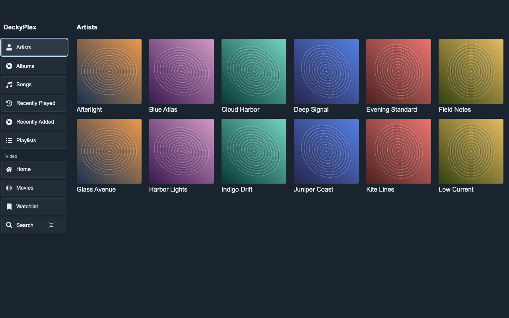
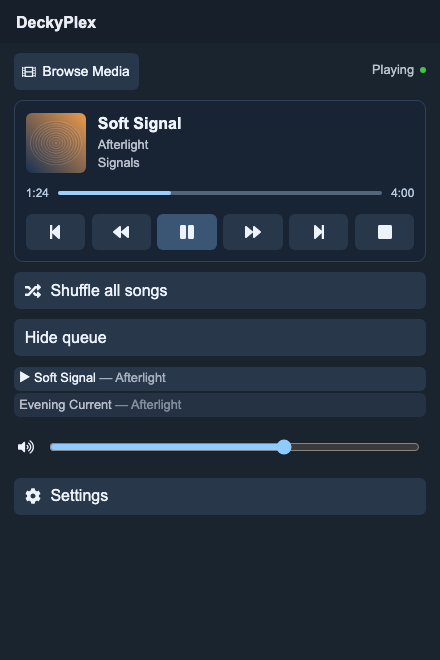

# DeckyPlex

Play Plex music, movies, and TV in Steam Gaming Mode. Browse your libraries with a controller, keep music playing while you game, or pop a video out over the game.

[Install DeckyPlex](#install-deckyplex) · [Features](#features) · [Contribute](#contributing)

## Features

- **Browse your libraries.** Find artists, albums, songs, and playlists, or browse selected movie, TV, and photo libraries. Press **Start** to jump to search and **Select** to sort a movie or TV library. Reorder or hide categories under **Settings → Interface → Library browser**.
- **Control playback from Quick Access.** Play, pause, skip, adjust volume, or edit the upcoming queue without leaving your game. During playback, **B** returns focus to Browse. Press **B** again there to close Quick Access.
- **Pick up where you left off.** Video Home brings together Continue Watching, Watch Next, recently added movies and TV, and your Plex Watchlist. With saved progress, choose **Resume** or **Start from beginning**. Episodes queue from the one you choose through the end of its season and can advance automatically.
- **Watch fullscreen or over a game.** Choose **Pop out** for picture-in-picture and **Full screen** in Quick Player to return. The video player offers captions and streaming quality controls. Press **B** in fullscreen to show the controls. Press **A** on the timeline, move left or right to preview a seek, then press **A** to apply it or **B** to cancel.
- **Use Plexamp as a remote.** Send music to the Deck, control it from your phone, and use **Play Next** on the shared queue. DeckyPlex can also send music to another Plex player.

## Screenshots

*The library browser and Quick Player with sample media from the UI tests.*





## Prerequisites

- A SteamOS device with [Decky Loader](https://github.com/SteamDeckHomebrew/decky-loader)
- **Developer mode** enabled in Decky Loader
- Access to a Plex Media Server

<details>
<summary>How to enable Developer mode</summary>

1. In Gaming Mode, press **…** to open **Quick Access**.
2. Open **Decky** (the plug icon) and select the **gear icon**.
3. In **General**, scroll to **Other** and turn on **Developer mode**.

</details>

## Install DeckyPlex

Find the `DeckyPlex-v*.zip` asset from the [latest GitHub release](https://github.com/opstormhq/DeckyPlex/releases/latest). Choose **one** of the methods below.

**Option 1 · Install from a URL (public releases)**

1. Copy the ZIP asset’s link from GitHub.
2. In Gaming Mode, open **Decky → Settings → Developer**.
3. Paste the link into **Install Plugin from URL**, select **Install**, and confirm when prompted.

**OR**

**Option 2 · Install from a downloaded ZIP**

1. In Desktop Mode, download the ZIP to **Downloads**.
2. Return to Gaming Mode and open **Decky → Settings → Developer**.
3. Under **Install Plugin from ZIP File**, select **Browse**, pick the downloaded ZIP, and confirm when prompted.

Open **DeckyPlex** from the Decky menu and select **Log in**. If your Plex server allows local access without signing in, enter its address under **Settings → Advanced** instead.

## Connect Plexamp

1. Open **Settings → Players**, enable **Plexamp receiver**, and check that the receiver reports ready.
2. With both devices on the same network, select DeckyPlex in Plexamp’s player picker. Set a distinct **Receiver device name** if you have more than one DeckyPlex device.
3. To send music the other way, select your phone or another Plex player as **Playback target** in the same settings tab.

Turning on the receiver during a song shares the Deck’s current queue at its playback position. Plex permissions determine which shared queues you can edit. The receiver listens on TCP port 32435 and uses Plex Companion discovery on the local network.

## Contributing

Bug fixes, controller and playback improvements, tests, and documentation are welcome. For a bug report, include your device, SteamOS and Decky Loader versions, steps to reproduce, and relevant log excerpts with personal server addresses and tokens removed. [Open an issue](https://github.com/opstormhq/DeckyPlex/issues/new)

### Branches and pull requests

1. Create a branch from `main` with a descriptive name such as `fix/local-library-picker` or `feature/caption-controls`. Branch names are free-form.
2. Open a pull request into `main` and describe what changed and how you tested it. Use a PR title like `fix: preselect music libraries` for a bug fix or `feat: add caption controls` for a feature.

Release Please uses the title of the squash-merge commit on `main` to group fixes and features into the next release.

### Build and test locally

Use Node.js 24 and Python 3.13 for local builds. Packaging also uses `pip`, `patch`, and `zip`.

```bash
npm ci
npm run check
npm test
npx playwright install --only-shell chromium
npm run test:ui
npm run package
python3 -m unittest discover -s tests
```

`npm run package` creates `DeckyPlex.zip` using the pinned Python dependencies, a PlexAPI queue compatibility patch, and Decky’s XML fallback. Set `PYTHON` if packaging should use a virtual environment’s interpreter.

If you test controller navigation, Plexamp casting, or over-game PiP on a Deck or Steam Machine, include what you tried and how it worked in your PR.

## License

[MIT](LICENSE)
